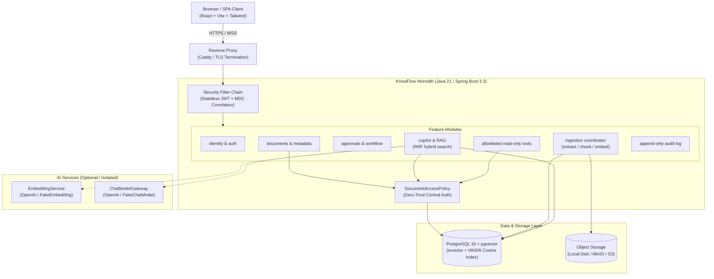

# KnowFlow — Enterprise AI Knowledge & Workflow Copilot

> A secure, governed enterprise knowledge copilot and workflow system. Employees search governed documents, submit documents for approval, track tasks, and ask an AI copilot questions answered **ONLY** from documents they are authorized to see, with verified citations (document title, exact version, page).

---

## 1. System Architecture

KnowFlow is structured as an enterprise modular monolith designed for strict zero-trust document security and graceful degradation:



---

## 2. Core Architectural Guarantees

1. **Server-Side Authorization Everywhere**: The acting user is derived strictly from `SecurityContext`. Document access permissions are applied **INSIDE SQL** queries (never fetch-then-filter), guaranteeing 0.00% information leakage.
2. **Graceful Degradation**: Core features (document management, approval workflows, task tracking, full-text keyword search) remain 100% functional even when external AI providers are unavailable (`knowflow.ai.enabled=false`).
3. **Untrusted Data Isolation**: Document content and tool outputs are treated as untrusted data. Prompt injection attempts cannot escalate privileges or trigger unapproved backend operations.
4. **Read-Only Tool Registry**: Copilot tools (`get_my_pending_approvals`, `get_task_status`, `search_accessible_documents`, `get_document_metadata`) are allowlisted, quota-capped, and strictly read-only.
5. **Deterministic Ingestion**: Document extraction (Apache PDFBox) and chunking run asynchronously in background jobs with lease timeouts, retry limits, and exponential backoff.
6. **Live Citation Verification**: Opening a citation re-verifies the user's *current* authorization in real-time, preventing Time-of-Check to Time-of-Use (TOCTOU) permission bypasses.

---

## 3. Technology Stack

- **Backend:** Java 21, Spring Boot 3.3.5, Spring Security, Spring Data JPA, Flyway, Apache PDFBox, Micrometer.
- **Database:** PostgreSQL 16+ with `pgvector` and full-text `tsvector`.
- **Frontend:** React 18, TypeScript, Tailwind CSS, Lucide React, TanStack Query, Vite.
- **Object Storage:** Pluggable `FileStorage` interface with local filesystem and S3/MinIO implementations.
- **Deployment & Ops:** Docker, Docker Compose, Caddy TLS reverse proxy, non-root alpine containers.

---

## 4. Quick Start Guide

### Option A: Local Development Setup

#### Prerequisites
- Java 21 LTS (`jdk-21` or `jdk-24`)
- Node.js 20+ & npm
- PostgreSQL 16 with pgvector running locally on port 5432

#### 1. Configure Environment
```bash
cp .env.example .env
```

#### 2. Run Backend Tests & Start
```bash
cd backend
./mvnw clean test
./mvnw spring-boot:run
```
- Swagger UI: `http://localhost:8080/swagger-ui`
- Prometheus Metrics: `http://localhost:8080/actuator/prometheus`
- Liveness Probe: `http://localhost:8080/actuator/health/liveness`
- Readiness Probe: `http://localhost:8080/actuator/health/readiness`

#### 3. Run Frontend
```bash
cd frontend
npm install
npm run dev
```
Open `http://localhost:5173` in your browser.

---

### Option B: Production-Ready Docker Compose

Launch the full stack with PostgreSQL (pgvector), MinIO S3, Backend, Frontend, and Caddy:

```bash
docker compose -f deploy/docker-compose.prod.yml up -d --build
```
Access the application at `http://localhost` (or configured TLS domain).

---

## 5. Seeded Synthetic Demo Users

| Email | Password | Role | Department | Description |
| :--- | :--- | :--- | :--- | :--- |
| `admin@knowflow.local` | `Password123!` | `ADMIN` | Executive | System administrator with global audit view |
| `km@knowflow.local` | `Password123!` | `KNOWLEDGE_MANAGER` | Legal | Manages document governance and categories |
| `approver@knowflow.local` | `Password123!` | `APPROVER` | Engineering | Reviews and approves document versions |
| `employee@knowflow.local` | `Password123!` | `EMPLOYEE` | Engineering | Searches documents, asks Copilot, tracks tasks |

---

## 6. Key API Examples

### 1. Inquire with RAG Copilot
```http
POST /api/v1/copilot/ask
Authorization: Bearer <access_token>
Content-Type: application/json

{
  "question": "What checks are required before starting the substation maintenance procedure?",
  "options": {
    "topK": 5,
    "maxTokens": 2048,
    "minScoreThreshold": 0.5
  }
}
```

**Response:**
```json
{
  "answer": "Before starting substation maintenance, three mandatory safety checks are required: 1. Confirm physical lock-out and tag-out (LOTO) on breaker panel B4. 2. Verify zero potential using a calibrated detector. 3. Secure secondary grounding cables to the ground bus.",
  "citations": [
    {
      "chunkId": "3fa85f64-5717-4562-b3fc-2c963f66afa6",
      "documentId": "c8b411d3-356a-4632-a6f9-03080ffb08bb",
      "documentTitle": "High-Voltage Substation Safety Procedure",
      "versionNumber": 1,
      "pageStart": 1,
      "pageEnd": 1,
      "snippet": "Before starting any maintenance on high-voltage equipment, three mandatory safety checks are required..."
    }
  ],
  "confidence": "ANSWERED",
  "retrievalMs": 42,
  "generationMs": 480
}
```

### 2. Multi-Turn Conversation Thread
```http
POST /api/v1/copilot/conversations
Authorization: Bearer <access_token>
Content-Type: application/json

{
  "title": "Substation Safety Inquiry"
}
```

### 3. Submit Message Feedback
```http
POST /api/v1/copilot/feedback
Authorization: Bearer <access_token>
Content-Type: application/json

{
  "messageId": "7b0a701f-0e9b-449e-876a-5c1cf7da5c6e",
  "rating": 5,
  "reasonCode": null,
  "comment": "Accurate citations and clear safety checklist."
}
```

---

## 7. Architecture Decision Records (ADRs)

| ADR | Title | Decision Summary |
| :--- | :--- | :--- |
| [ADR-001](docs/adr/ADR-001-modular-monolith-architecture.md) | Modular Monolith Architecture | Package-by-feature under `com.knowflow.*` without circular dependencies. |
| [ADR-002](docs/adr/ADR-002-authentication-local-jwt.md) | Authentication & Local JWT | Stateless JWTs with refresh token rotation and revoke list. |
| [ADR-003](docs/adr/ADR-003-file-storage.md) | File Storage Strategy | Pluggable `FileStorage` interface with Local and S3/MinIO drivers. |
| [ADR-004](docs/adr/ADR-004-postgresql-search-pgvector.md) | PostgreSQL Full-Text & pgvector | Single database for relational data, tsvector BM25, and vector cosine search. |
| [ADR-005](docs/adr/ADR-005-chunking-embedding.md) | Chunking & Embedding Pipeline | 500-token chunks with 50-token overlap, page-aware PDFBox extraction. |
| [ADR-006](docs/adr/ADR-006-llm-provider.md) | LLM Provider Gateway | Decoupled `ChatModelGateway` with XML-delimited prompt templates. |
| [ADR-007](docs/adr/ADR-007-database-backed-job-queue.md) | DB-Backed Job Queue | Lease-based asynchronous ingestion coordinator avoiding external brokers. |
| [ADR-008](docs/adr/ADR-008-audit-retention.md) | Audit & Retention Policies | Append-only audit tables and scheduled 90-day conversation purge jobs. |
| [ADR-009](docs/adr/ADR-009-tool-calling-and-write-safety.md) | Tool Calling & Write Safety | Allowlisted read-only tools; write tools strictly prohibited without explicit UI re-auth. |

---

## 8. Known Limitations

- **Single Active Pipeline**: Re-embedding an entire corpus with a new dimension requires running an explicit batch migration script rather than hot multi-model switching.
- **PDF Scanned Images (OCR)**: Ingestion extracts text layers via Apache PDFBox. Scanned image-only PDFs without OCR layers require an upstream OCR pipeline.
- **In-Memory Rate Limiting**: The current rate limiter runs in-process via Bucket4j. Horizontal clustering across multiple backend instances will require a shared Redis token bucket.

---

## 9. Future Work & Roadmap

1. **Enterprise OIDC & SAML 2.0 Integration**: Map corporate IdPs (Okta, Entra ID, Ping) directly into KnowFlow departmental roles.
2. **Write Tools with Dual-Step Confirmation**: Allow Copilot to propose write actions (e.g., initiating approval requests) that require an explicit human-in-the-loop UI confirmation modal and re-authorization before execution.
3. **Asynchronous Broker Extraction**: Migrate the DB-backed ingestion queue to RabbitMQ or Apache Kafka once continuous document ingestion volume exceeds 5,000 documents/hour.
