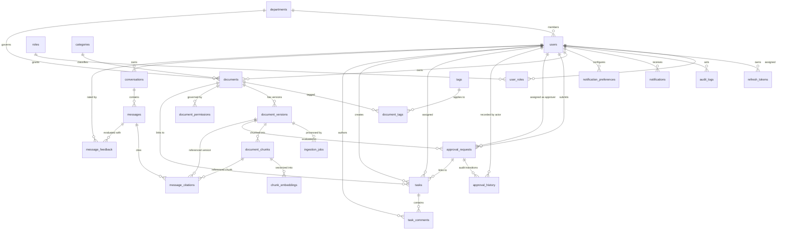

# KnowFlow — Entity Relationship Diagram & Data Persistence Model

> **Status:** Baseline Design (Phase 0)  
> **Database:** PostgreSQL 16+ with extensions `pgcrypto`, `uuid-ossp`, and `vector` (pgvector)  
> **Key Conventions:** UUID v4 Primary Keys, UTC Timestamps (`TIMESTAMPTZ`), Snake_case SQL identifiers, Optimistic Locking (`@Version`), Explicit Enums as VARCHAR with CHECK constraints.

---

## 1. Visual Entity Relationship Diagram (Mermaid)

---

## 2. Relational Schema & Table Definitions

### 2.1 Identity & Access Control

#### `departments`
Stores organizational business units for access partitioning.
| Column | Type | Constraints | Description |
|---|---|---|---|
| `id` | UUID | PK, DEFAULT gen_random_uuid() | Department identifier |
| `name` | VARCHAR(100) | UNIQUE, NOT NULL | Department name (e.g., Engineering) |
| `description` | TEXT | NULL | Department mission/scope |
| `created_at` | TIMESTAMPTZ | NOT NULL, DEFAULT NOW() | Record creation timestamp |
| `updated_at` | TIMESTAMPTZ | NOT NULL, DEFAULT NOW() | Last update timestamp |

#### `users`
Authenticated human actors and system actors.
| Column | Type | Constraints | Description |
|---|---|---|---|
| `id` | UUID | PK, DEFAULT gen_random_uuid() | Internal user ID |
| `email` | VARCHAR(255) | UNIQUE, NOT NULL | Lowercase normalized email |
| `display_name` | VARCHAR(150) | NOT NULL | User's full name |
| `password_hash` | VARCHAR(255) | NULL | Argon2id/BCrypt hash (NULL if OIDC) |
| `identity_subject` | VARCHAR(255) | UNIQUE, NULL | Subject claim from OIDC provider |
| `status` | VARCHAR(30) | NOT NULL, DEFAULT 'ACTIVE' | `ACTIVE`, `INACTIVE`, `SUSPENDED` |
| `department_id` | UUID | FK -> departments(id), NULL | Primary department |
| `created_at` | TIMESTAMPTZ | NOT NULL, DEFAULT NOW() | Account creation date |
| `updated_at` | TIMESTAMPTZ | NOT NULL, DEFAULT NOW() | Last profile modification |

*Indexes:*
- `idx_users_email` (UNIQUE)
- `idx_users_department_id`
- `idx_users_status`

#### `roles`
Platform security roles.
| Column | Type | Constraints | Description |
|---|---|---|---|
| `id` | UUID | PK, DEFAULT gen_random_uuid() | Role identifier |
| `name` | VARCHAR(50) | UNIQUE, NOT NULL | `EMPLOYEE`, `KNOWLEDGE_MANAGER`, `APPROVER`, `ADMIN`, `SYSTEM_WORKER` |
| `description` | TEXT | NULL | Role scope explanation |

#### `user_roles`
Many-to-many role assignments.
| Column | Type | Constraints | Description |
|---|---|---|---|
| `user_id` | UUID | PK, FK -> users(id) ON DELETE CASCADE | Associated user |
| `role_id` | UUID | PK, FK -> roles(id) ON DELETE CASCADE | Associated role |

#### `refresh_tokens`
Hashed refresh tokens supporting secure token rotation and revocation.
| Column | Type | Constraints | Description |
|---|---|---|---|
| `id` | UUID | PK, DEFAULT gen_random_uuid() | Token ID |
| `user_id` | UUID | NOT NULL, FK -> users(id) ON DELETE CASCADE | Token owner |
| `token_hash` | VARCHAR(255) | UNIQUE, NOT NULL | SHA-256 hash of random refresh token |
| `expires_at` | TIMESTAMPTZ | NOT NULL | Expiry threshold (typically 7 days) |
| `revoked` | BOOLEAN | NOT NULL, DEFAULT FALSE | Revocation status flag |
| `created_at` | TIMESTAMPTZ | NOT NULL, DEFAULT NOW() | Issuance timestamp |

---

### 2.2 Document Library & Governance

#### `categories`
Hierarchical taxonomy for organizing documents.
| Column | Type | Constraints | Description |
|---|---|---|---|
| `id` | UUID | PK, DEFAULT gen_random_uuid() | Category identifier |
| `name` | VARCHAR(100) | UNIQUE, NOT NULL | Category label |
| `description` | TEXT | NULL | Classification guidelines |

#### `tags`
Normalized labels for cross-cutting document search.
| Column | Type | Constraints | Description |
|---|---|---|---|
| `id` | UUID | PK, DEFAULT gen_random_uuid() | Tag identifier |
| `name` | VARCHAR(50) | UNIQUE, NOT NULL | Lowercase normalized tag name |

#### `documents`
Governed document metadata root.
| Column | Type | Constraints | Description |
|---|---|---|---|
| `id` | UUID | PK, DEFAULT gen_random_uuid() | Document identifier |
| `title` | VARCHAR(255) | NOT NULL | Title of the document |
| `description` | TEXT | NULL | High-level summary |
| `owner_id` | UUID | NOT NULL, FK -> users(id) | Primary document custodian |
| `department_id` | UUID | FK -> departments(id), NULL | Owning department |
| `category_id` | UUID | FK -> categories(id), NULL | Document category |
| `classification` | VARCHAR(30) | NOT NULL, DEFAULT 'INTERNAL' | `PUBLIC`, `INTERNAL`, `CONFIDENTIAL`, `RESTRICTED` |
| `status` | VARCHAR(30) | NOT NULL, DEFAULT 'DRAFT' | `DRAFT`, `IN_REVIEW`, `APPROVED`, `ARCHIVED` |
| `current_version_id`| UUID | NULL | Points to current active version |
| `expiry_at` | TIMESTAMPTZ | NULL | Expiration date for compliance |
| `version` | INTEGER | NOT NULL, DEFAULT 0 | Optimistic locking counter |
| `tsv_metadata` | TSVECTOR | NULL | Generated tsvector for title/desc |
| `created_at` | TIMESTAMPTZ | NOT NULL, DEFAULT NOW() | Inception timestamp |
| `updated_at` | TIMESTAMPTZ | NOT NULL, DEFAULT NOW() | Last modification timestamp |

*Indexes:*
- `idx_documents_owner` (`owner_id`)
- `idx_documents_department` (`department_id`)
- `idx_documents_category` (`category_id`)
- `idx_documents_status` (`status`)
- `idx_documents_classification` (`classification`)
- `idx_documents_expiry` (`expiry_at`)
- `idx_documents_tsv` USING GIN (`tsv_metadata`)

#### `document_versions`
Immutable document version binaries and verification hashes.
| Column | Type | Constraints | Description |
|---|---|---|---|
| `id` | UUID | PK, DEFAULT gen_random_uuid() | Version identifier |
| `document_id` | UUID | NOT NULL, FK -> documents(id) ON DELETE CASCADE | Parent document |
| `version_number` | INTEGER | NOT NULL | Incremental version number (1, 2, ...) |
| `storage_key` | VARCHAR(500) | UNIQUE, NOT NULL | UUID-based path in storage volume |
| `checksum` | VARCHAR(64) | NOT NULL | SHA-256 digest of stored bytes |
| `mime_type` | VARCHAR(100) | NOT NULL | Validated MIME type (e.g. `application/pdf`)|
| `size_bytes` | BIGINT | NOT NULL | Exact byte size of file |
| `uploaded_by` | UUID | NOT NULL, FK -> users(id) | Uploader user ID |
| `change_note` | TEXT | NULL | Reason for change/revision notes |
| `processing_status`| VARCHAR(30) | NOT NULL, DEFAULT 'PENDING' | `PENDING`, `PROCESSING`, `READY`, `READY_KEYWORD_ONLY`, `FAILED` |
| `created_at` | TIMESTAMPTZ | NOT NULL, DEFAULT NOW() | Upload timestamp |

*Constraints & Indexes:*
- `uq_document_version` UNIQUE (`document_id`, `version_number`)
- `idx_doc_versions_doc_id` (`document_id`)
- `idx_doc_versions_status` (`processing_status`)

#### `document_tags`
Join table linking documents to tags.
| Column | Type | Constraints | Description |
|---|---|---|---|
| `document_id` | UUID | PK, FK -> documents(id) ON DELETE CASCADE | Document reference |
| `tag_id` | UUID | PK, FK -> tags(id) ON DELETE CASCADE | Tag reference |

#### `document_permissions`
Explicit Access Control List (ACL) overriding or supplementing baseline rules.
| Column | Type | Constraints | Description |
|---|---|---|---|
| `id` | UUID | PK, DEFAULT gen_random_uuid() | ACL entry identifier |
| `document_id` | UUID | NOT NULL, FK -> documents(id) ON DELETE CASCADE | Target document |
| `principal_type` | VARCHAR(30) | NOT NULL | `USER`, `DEPARTMENT`, `GROUP` |
| `principal_id` | UUID | NOT NULL | ID of the principal |
| `permission_level` | VARCHAR(30) | NOT NULL | `VIEW`, `EDIT`, `MANAGE` |
| `created_at` | TIMESTAMPTZ | NOT NULL, DEFAULT NOW() | Granted timestamp |

*Constraints & Indexes:*
- `uq_doc_principal` UNIQUE (`document_id`, `principal_type`, `principal_id`)
- `idx_doc_perm_principal` (`principal_type`, `principal_id`)

---

### 2.3 Async Ingestion & Vector Retrieval

#### `ingestion_jobs`
Durable tracking for background extraction, chunking, and indexing.
| Column | Type | Constraints | Description |
|---|---|---|---|
| `id` | UUID | PK, DEFAULT gen_random_uuid() | Job identifier |
| `version_id` | UUID | NOT NULL, FK -> document_versions(id) ON DELETE CASCADE | Associated document version |
| `pipeline_version` | VARCHAR(50) | NOT NULL | Pipeline version identifier (e.g. `v1.0.0`) |
| `status` | VARCHAR(30) | NOT NULL, DEFAULT 'PENDING' | `PENDING`, `RUNNING`, `SUCCEEDED`, `FAILED`, `RETRY_SCHEDULED` |
| `attempts` | INTEGER | NOT NULL, DEFAULT 0 | Attempt count |
| `max_attempts` | INTEGER | NOT NULL, DEFAULT 3 | Retry limit |
| `next_attempt_at` | TIMESTAMPTZ | NULL | Exponential backoff target |
| `started_at` | TIMESTAMPTZ | NULL | Job start time |
| `finished_at` | TIMESTAMPTZ | NULL | Job completion time |
| `error_code` | VARCHAR(100) | NULL | Safe error code (e.g., `PARSER_TIMEOUT`) |
| `locked_by` | VARCHAR(100) | NULL | Worker instance identity claiming job |
| `locked_until` | TIMESTAMPTZ | NULL | Lease expiration timestamp |
| `created_at` | TIMESTAMPTZ | NOT NULL, DEFAULT NOW() | Enqueue timestamp |

*Constraints & Indexes:*
- `uq_job_version_pipeline` UNIQUE (`version_id`, `pipeline_version`)
- `idx_jobs_claim` (`status`, `next_attempt_at`, `locked_until`)

#### `document_chunks`
Extracted textual spans with spatial page reference mapping.
| Column | Type | Constraints | Description |
|---|---|---|---|
| `id` | UUID | PK, DEFAULT gen_random_uuid() | Chunk identifier |
| `version_id` | UUID | NOT NULL, FK -> document_versions(id) ON DELETE CASCADE | Source document version |
| `chunk_index` | INTEGER | NOT NULL | Sequential chunk order index (0, 1, ...) |
| `text` | TEXT | NOT NULL | Extracted text content |
| `page_start` | INTEGER | NULL | Starting page number (1-based) |
| `page_end` | INTEGER | NULL | Ending page number (1-based) |
| `token_estimate` | INTEGER | NULL | Estimated token count |
| `content_hash` | VARCHAR(64) | NOT NULL | SHA-256 hash of text for deduplication |
| `tsv_chunk` | TSVECTOR | NULL | tsvector for chunk-level keyword search |
| `created_at` | TIMESTAMPTZ | NOT NULL, DEFAULT NOW() | Extraction timestamp |

*Constraints & Indexes:*
- `uq_chunk_version_index` UNIQUE (`version_id`, `chunk_index`)
- `idx_chunks_version` (`version_id`)
- `idx_chunks_tsv` USING GIN (`tsv_chunk`)

#### `chunk_embeddings`
High-dimensional dense vector embeddings generated via pgvector.
| Column | Type | Constraints | Description |
|---|---|---|---|
| `id` | UUID | PK, DEFAULT gen_random_uuid() | Embedding record ID |
| `chunk_id` | UUID | NOT NULL, FK -> document_chunks(id) ON DELETE CASCADE | Associated chunk |
| `embedding` | VECTOR(1536) | NOT NULL | Vector embedding (dimensions per ADR-005) |
| `embedding_model` | VARCHAR(100) | NOT NULL | Model identifier (e.g. `text-embedding-3-small`) |
| `dimensions` | INTEGER | NOT NULL | Validated vector dimensions |
| `pipeline_version` | VARCHAR(50) | NOT NULL | Vector pipeline version |
| `created_at` | TIMESTAMPTZ | NOT NULL, DEFAULT NOW() | Generation timestamp |

*Indexes:*
- `idx_chunk_embeddings_hnsw` USING HNSW (`embedding` vector_cosine_ops)
- `idx_chunk_embeddings_chunk_id` (`chunk_id`)

---

### 2.4 Review & Approval Workflows

#### `approval_requests`
Explicit review assignments binding to an exact document version.
| Column | Type | Constraints | Description |
|---|---|---|---|
| `id` | UUID | PK, DEFAULT gen_random_uuid() | Approval request identifier |
| `document_version_id`| UUID | NOT NULL, FK -> document_versions(id) | Subject version under evaluation |
| `submitted_by` | UUID | NOT NULL, FK -> users(id) | Request creator |
| `approver_id` | UUID | NOT NULL, FK -> users(id) | Assigned reviewer (must != submitted_by) |
| `status` | VARCHAR(30) | NOT NULL, DEFAULT 'PENDING' | `PENDING`, `APPROVED`, `REJECTED`, `CHANGES_REQUESTED` |
| `submitted_at` | TIMESTAMPTZ | NOT NULL, DEFAULT NOW() | Submission timestamp |
| `completed_at` | TIMESTAMPTZ | NULL | Finalization timestamp |
| `version` | INTEGER | NOT NULL, DEFAULT 0 | Optimistic locking counter |

*Indexes:*
- `idx_approvals_approver_status` (`approver_id`, `status`)
- `idx_approvals_version` (`document_version_id`)

#### `approval_history`
Append-only immutable audit trail of review decisions.
| Column | Type | Constraints | Description |
|---|---|---|---|
| `id` | UUID | PK, DEFAULT gen_random_uuid() | History entry ID |
| `request_id` | UUID | NOT NULL, FK -> approval_requests(id) ON DELETE CASCADE | Target request |
| `actor_id` | UUID | NOT NULL, FK -> users(id) | Reviewer taking action |
| `action` | VARCHAR(50) | NOT NULL | `SUBMIT`, `APPROVE`, `REJECT`, `REQUEST_CHANGES` |
| `comment` | TEXT | NULL | Reviewer justification (mandatory on reject) |
| `from_state` | VARCHAR(30) | NOT NULL | Prior status |
| `to_state` | VARCHAR(30) | NOT NULL | New status |
| `created_at` | TIMESTAMPTZ | NOT NULL, DEFAULT NOW() | Event timestamp |

*Indexes:*
- `idx_approval_hist_request` (`request_id`, `created_at`)

---

### 2.5 Tasks & Notifications

#### `tasks`
Work items linked to documents or approval workflows.
| Column | Type | Constraints | Description |
|---|---|---|---|
| `id` | UUID | PK, DEFAULT gen_random_uuid() | Task identifier |
| `title` | VARCHAR(255) | NOT NULL | Task summary |
| `description` | TEXT | NULL | Detailed instructions |
| `assignee_id` | UUID | NOT NULL, FK -> users(id) | Designated worker |
| `creator_id` | UUID | NOT NULL, FK -> users(id) | Task author |
| `linked_document_id`| UUID | FK -> documents(id), NULL | Associated document |
| `linked_approval_id`| UUID | FK -> approval_requests(id), NULL | Associated review item |
| `priority` | VARCHAR(20) | NOT NULL, DEFAULT 'MEDIUM' | `LOW`, `MEDIUM`, `HIGH`, `URGENT` |
| `status` | VARCHAR(30) | NOT NULL, DEFAULT 'OPEN' | `OPEN`, `IN_PROGRESS`, `DONE`, `CANCELLED` |
| `due_at` | TIMESTAMPTZ | NULL | Due date for completion |
| `completion_note` | TEXT | NULL | Outcome/resolution details |
| `version` | INTEGER | NOT NULL, DEFAULT 0 | Optimistic locking counter |
| `created_at` | TIMESTAMPTZ | NOT NULL, DEFAULT NOW() | Task creation time |
| `updated_at` | TIMESTAMPTZ | NOT NULL, DEFAULT NOW() | Last status update |

*Indexes:*
- `idx_tasks_assignee_status` (`assignee_id`, `status`)
- `idx_tasks_due_at` (`due_at`)

#### `task_comments`
Chronological discussion threads on tasks.
| Column | Type | Constraints | Description |
|---|---|---|---|
| `id` | UUID | PK, DEFAULT gen_random_uuid() | Comment ID |
| `task_id` | UUID | NOT NULL, FK -> tasks(id) ON DELETE CASCADE | Associated task |
| `author_id` | UUID | NOT NULL, FK -> users(id) | Commenter |
| `content` | TEXT | NOT NULL | Comment message |
| `created_at` | TIMESTAMPTZ | NOT NULL, DEFAULT NOW() | Submission timestamp |

#### `notifications`
In-app notification inbox items with idempotency deduplication.
| Column | Type | Constraints | Description |
|---|---|---|---|
| `id` | UUID | PK, DEFAULT gen_random_uuid() | Notification identifier |
| `user_id` | UUID | NOT NULL, FK -> users(id) ON DELETE CASCADE | Recipient |
| `type` | VARCHAR(50) | NOT NULL | E.g. `APPROVAL_ASSIGNED`, `TASK_OVERDUE` |
| `title` | VARCHAR(255) | NOT NULL | Headline |
| `message` | TEXT | NOT NULL | Body narrative |
| `payload` | JSONB | NULL | Context IDs (documentId, taskId, etc.) |
| `read_at` | TIMESTAMPTZ | NULL | Timestamp when viewed (NULL = unread) |
| `dedupe_key` | VARCHAR(255) | UNIQUE, NULL | Idempotency key preventing duplicates |
| `created_at` | TIMESTAMPTZ | NOT NULL, DEFAULT NOW() | Issuance timestamp |

*Indexes:*
- `idx_notifications_user_unread` (`user_id`, `read_at`)

#### `notification_preferences`
Per-user communication channel and alert toggles.
| Column | Type | Constraints | Description |
|---|---|---|---|
| `id` | UUID | PK, DEFAULT gen_random_uuid() | Preference record ID |
| `user_id` | UUID | NOT NULL, FK -> users(id) ON DELETE CASCADE | Target user |
| `notification_type` | VARCHAR(50) | NOT NULL | Specific event notification code |
| `enabled` | BOOLEAN | NOT NULL, DEFAULT TRUE | User preference flag |

*Constraints:*
- `uq_user_notif_pref` UNIQUE (`user_id`, `notification_type`)

---

### 2.6 AI Copilot Conversations, Citations & Feedback

#### `conversations`
User-owned AI dialogue sessions.
| Column | Type | Constraints | Description |
|---|---|---|---|
| `id` | UUID | PK, DEFAULT gen_random_uuid() | Conversation identifier |
| `owner_id` | UUID | NOT NULL, FK -> users(id) ON DELETE CASCADE | Initiating user |
| `title` | VARCHAR(255) | NULL | Dynamic topic summary |
| `created_at` | TIMESTAMPTZ | NOT NULL, DEFAULT NOW() | Initiation time |
| `updated_at` | TIMESTAMPTZ | NOT NULL, DEFAULT NOW() | Last message time |
| `expires_at` | TIMESTAMPTZ | NULL | Retention purge timestamp (per ADR-008) |

*Indexes:*
- `idx_conversations_owner` (`owner_id`, `updated_at` DESC)
- `idx_conversations_retention` (`expires_at`)

#### `messages`
Individual dialogue turns between User and Assistant.
| Column | Type | Constraints | Description |
|---|---|---|---|
| `id` | UUID | PK, DEFAULT gen_random_uuid() | Message identifier |
| `conversation_id` | UUID | NOT NULL, FK -> conversations(id) ON DELETE CASCADE | Parent conversation |
| `role` | VARCHAR(20) | NOT NULL | `USER`, `ASSISTANT`, `SYSTEM` |
| `content` | TEXT | NOT NULL | Dialogue content |
| `model` | VARCHAR(100) | NULL | Model identifier utilized |
| `prompt_version` | VARCHAR(50) | NULL | Versioned prompt template used |
| `retrieval_ms` | INTEGER | NULL | Latency of retrieval phase |
| `generation_ms` | INTEGER | NULL | Latency of generation phase |
| `token_count` | INTEGER | NULL | Prompt + completion tokens used |
| `created_at` | TIMESTAMPTZ | NOT NULL, DEFAULT NOW() | Message timestamp |

*Indexes:*
- `idx_messages_conversation` (`conversation_id`, `created_at`)

#### `message_citations`
Source grounding references validating copilot statements against immutable versions.
| Column | Type | Constraints | Description |
|---|---|---|---|
| `id` | UUID | PK, DEFAULT gen_random_uuid() | Citation record ID |
| `message_id` | UUID | NOT NULL, FK -> messages(id) ON DELETE CASCADE | AI message containing claim |
| `chunk_id` | UUID | NULL, FK -> document_chunks(id) ON DELETE SET NULL | Underlying chunk retrieved |
| `version_id` | UUID | NOT NULL, FK -> document_versions(id) | Exact version quoted |
| `document_title` | VARCHAR(255) | NOT NULL | Snapshot of title at retrieval |
| `version_number` | INTEGER | NOT NULL | Snapshot of version number |
| `page_start` | INTEGER | NULL | Source page start |
| `page_end` | INTEGER | NULL | Source page end |
| `snippet` | TEXT | NULL | Verbatim text evidence |

#### `message_feedback`
User quality assessment and issue categorization.
| Column | Type | Constraints | Description |
|---|---|---|---|
| `id` | UUID | PK, DEFAULT gen_random_uuid() | Feedback identifier |
| `message_id` | UUID | UNIQUE, NOT NULL, FK -> messages(id) ON DELETE CASCADE | Targeted AI message |
| `user_id` | UUID | NOT NULL, FK -> users(id) | Reviewing user |
| `rating` | VARCHAR(20) | NOT NULL | `THUMBS_UP`, `THUMBS_DOWN` |
| `reason_code` | VARCHAR(50) | NULL | `INCORRECT`, `INCOMPLETE`, `UNSUPPORTED_CITATION`, `OUTDATED_SOURCE`, `PERMISSION_ISSUE` |
| `comment` | TEXT | NULL | Qualitative explanation |
| `created_at` | TIMESTAMPTZ | NOT NULL, DEFAULT NOW() | Submission timestamp |

---

### 2.7 Platform Audit & Compliance

#### `audit_logs`
Append-only, immutable activity log capturing security-relevant transactions.
| Column | Type | Constraints | Description |
|---|---|---|---|
| `id` | UUID | PK, DEFAULT gen_random_uuid() | Audit event identifier |
| `actor_id` | UUID | NULL, FK -> users(id) ON DELETE SET NULL | Acting user (NULL if anonymous/system) |
| `action` | VARCHAR(100) | NOT NULL | E.g. `DOCUMENT_UPLOAD`, `PERMISSION_CHANGE`, `LOGIN_FAILURE` |
| `entity_type` | VARCHAR(50) | NOT NULL | Target entity type (`DOCUMENT`, `USER`, etc.) |
| `entity_id` | UUID | NULL | Identifier of affected target |
| `detail` | JSONB | NULL | Structured before/after diff (redacted) |
| `correlation_id` | VARCHAR(100) | NULL | Distributed request trace ID |
| `ip_address` | VARCHAR(45) | NULL | Client IP |
| `created_at` | TIMESTAMPTZ | NOT NULL, DEFAULT NOW() | Event timestamp |

*Indexes:*
- `idx_audit_actor` (`actor_id`)
- `idx_audit_action` (`action`)
- `idx_audit_entity` (`entity_type`, `entity_id`)
- `idx_audit_created` (`created_at`)

---

## 3. Flyway Migration Sequencing Strategy

1. `V1__init_extensions.sql` — Install `uuid-ossp`, `pgcrypto`, and `vector`
2. `V2__identity_and_roles.sql` — Tables: `departments`, `users`, `roles`, `user_roles`, `refresh_tokens`
3. `V3__audit_logging.sql` — Table: `audit_logs`
4. `V4__documents_and_permissions.sql` — Tables: `categories`, `tags`, `documents`, `document_versions`, `document_tags`, `document_permissions`
5. `V5__search_fts_indexes.sql` — Generated tsvector columns and GIN indexes on documents & categories
6. `V6__workflow_approvals.sql` — Tables: `approval_requests`, `approval_history`
7. `V7__tasks_and_notifications.sql` — Tables: `tasks`, `task_comments`, `notifications`, `notification_preferences`
8. `V8__async_ingestion_chunks.sql` — Tables: `ingestion_jobs`, `document_chunks` (with tsvector)
9. `V9__vector_embeddings.sql` — Table: `chunk_embeddings` with HNSW vector index
10. `V10__copilot_conversations_feedback.sql` — Tables: `conversations`, `messages`, `message_citations`, `message_feedback`
