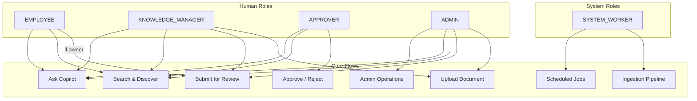

# KnowFlow — Role & Capability Matrix

> **Document Status:** Living document — updated as capabilities are added.
> **Related Docs:** [REQUIREMENTS.md](./REQUIREMENTS.md) · [ASSUMPTIONS.md](./ASSUMPTIONS.md)

## Roles Overview

| Role | Description | Interactive Login |
|------|-------------|:-----------------:|
| **EMPLOYEE** | Default role for all staff. Can search, read authorized docs, use copilot, manage own tasks. | ✅ |
| **KNOWLEDGE_MANAGER** | Manages documents, metadata, and permissions within their department scope. | ✅ |
| **APPROVER** | Reviews and decides on document submissions assigned to them. | ✅ |
| **ADMIN** | Full platform administration: users, departments, categories, audit, reporting. | ✅ |
| **SYSTEM_WORKER** | Non-human service account for scheduled jobs, ingestion pipeline, internal operations. | ❌ |

> [!NOTE]
> Users can hold **multiple roles** simultaneously (e.g., KNOWLEDGE_MANAGER + APPROVER). Permissions are additive — the union of all granted roles applies.

---

## Capability Matrix

Legend:
- ✅ = Allowed
- ❌ = Denied
- ⚠️ = Conditional (see Notes column)

### 1. Identity & Account Management

| # | Capability | EMPLOYEE | KNOWLEDGE_MANAGER | APPROVER | ADMIN | SYSTEM_WORKER | Notes |
|---|-----------|:--------:|:------------------:|:--------:|:-----:|:-------------:|-------|
| 1.1 | Login / Logout | ✅ | ✅ | ✅ | ✅ | ❌ | SYSTEM_WORKER authenticates via service token, not interactive login |
| 1.2 | View own profile | ✅ | ✅ | ✅ | ✅ | ❌ | |
| 1.3 | Update own profile (name, preferences) | ✅ | ✅ | ✅ | ✅ | ❌ | |
| 1.4 | Create user accounts | ❌ | ❌ | ❌ | ✅ | ❌ | |
| 1.5 | Deactivate user accounts | ❌ | ❌ | ❌ | ✅ | ❌ | Admin cannot deactivate their own account |
| 1.6 | Assign / remove roles | ❌ | ❌ | ❌ | ✅ | ❌ | Cannot assign SYSTEM_WORKER role |
| 1.7 | Create / rename / deactivate departments | ❌ | ❌ | ❌ | ✅ | ❌ | |
| 1.8 | Request password reset | ✅ | ✅ | ✅ | ✅ | ❌ | |
| 1.9 | View other users' profiles (basic info) | ❌ | ⚠️ | ⚠️ | ✅ | ❌ | KM/APPROVER can view basic info of users in their scope (for assignment) |

### 2. Document Library & Versioning

| # | Capability | EMPLOYEE | KNOWLEDGE_MANAGER | APPROVER | ADMIN | SYSTEM_WORKER | Notes |
|---|-----------|:--------:|:------------------:|:--------:|:-----:|:-------------:|-------|
| 2.1 | Upload new document | ❌ | ✅ | ❌ | ✅ | ❌ | |
| 2.2 | View document metadata | ⚠️ | ⚠️ | ⚠️ | ⚠️ | ❌ | Subject to DocumentAccessPolicy; returns 404 if unauthorized |
| 2.3 | View version history | ⚠️ | ⚠️ | ⚠️ | ⚠️ | ❌ | Same access rules as document metadata |
| 2.4 | Upload new version | ⚠️ | ⚠️ | ❌ | ✅ | ❌ | Owner or KM for the document's department |
| 2.5 | Update document metadata | ⚠️ | ⚠️ | ❌ | ✅ | ❌ | Owner or KM for the document's department |
| 2.6 | Archive document | ❌ | ⚠️ | ❌ | ✅ | ❌ | KM only within their department scope |
| 2.7 | Restore archived document | ❌ | ⚠️ | ❌ | ✅ | ❌ | KM only within their department scope |
| 2.8 | Set expiry date | ❌ | ⚠️ | ❌ | ✅ | ❌ | KM only within their department scope |
| 2.9 | Manage categories (CRUD) | ❌ | ❌ | ❌ | ✅ | ❌ | |

### 3. Document Permissions & Access Control

| # | Capability | EMPLOYEE | KNOWLEDGE_MANAGER | APPROVER | ADMIN | SYSTEM_WORKER | Notes |
|---|-----------|:--------:|:------------------:|:--------:|:-----:|:-------------:|-------|
| 3.1 | View document permissions list | ⚠️ | ⚠️ | ❌ | ✅ | ❌ | Owner or users with MANAGE level |
| 3.2 | Grant / revoke permissions | ⚠️ | ⚠️ | ❌ | ✅ | ❌ | Owner (MANAGE level) or KM within department scope |
| 3.3 | Download document | ⚠️ | ⚠️ | ⚠️ | ⚠️ | ❌ | Subject to per-request DocumentAccessPolicy evaluation |
| 3.4 | Access PUBLIC documents | ✅ | ✅ | ✅ | ✅ | ❌ | |
| 3.5 | Access INTERNAL documents | ✅ | ✅ | ✅ | ✅ | ❌ | |
| 3.6 | Access CONFIDENTIAL documents | ⚠️ | ⚠️ | ⚠️ | ⚠️ | ❌ | Requires explicit permission, ownership, or ADMIN role |
| 3.7 | Access RESTRICTED documents | ⚠️ | ⚠️ | ⚠️ | ⚠️ | ❌ | Requires explicit user/group permission or ownership — ADMIN role alone is NOT sufficient |

### 4. Search & Discovery

| # | Capability | EMPLOYEE | KNOWLEDGE_MANAGER | APPROVER | ADMIN | SYSTEM_WORKER | Notes |
|---|-----------|:--------:|:------------------:|:--------:|:-----:|:-------------:|-------|
| 4.1 | Keyword full-text search | ✅ | ✅ | ✅ | ✅ | ❌ | Results ACL-filtered; works when AI is down |
| 4.2 | Filter by category, department, status, etc. | ✅ | ✅ | ✅ | ✅ | ❌ | |
| 4.3 | See result counts / facets | ✅ | ✅ | ✅ | ✅ | ❌ | Counts reflect only accessible documents |

### 5. Review & Approval Workflow

| # | Capability | EMPLOYEE | KNOWLEDGE_MANAGER | APPROVER | ADMIN | SYSTEM_WORKER | Notes |
|---|-----------|:--------:|:------------------:|:--------:|:-----:|:-------------:|-------|
| 5.1 | Submit version for review | ⚠️ | ✅ | ❌ | ✅ | ❌ | EMPLOYEE only if they are the document owner |
| 5.2 | Assign approver | ⚠️ | ✅ | ❌ | ✅ | ❌ | Assignee must hold APPROVER role; self-assignment blocked |
| 5.3 | Make approval decision (APPROVE / REJECT / CHANGES_REQUESTED) | ❌ | ❌ | ⚠️ | ❌ | ❌ | Only the assigned APPROVER for that specific review |
| 5.4 | View approval history | ⚠️ | ⚠️ | ⚠️ | ✅ | ❌ | Owner, KM for the department, assigned approver, or ADMIN |
| 5.5 | Self-approve own submission | ❌ | ❌ | ❌ | ❌ | ❌ | **Blocked for ALL roles** — no exceptions |

### 6. Tasks & Notifications

| # | Capability | EMPLOYEE | KNOWLEDGE_MANAGER | APPROVER | ADMIN | SYSTEM_WORKER | Notes |
|---|-----------|:--------:|:------------------:|:--------:|:-----:|:-------------:|-------|
| 6.1 | Create tasks | ❌ | ✅ | ✅ | ✅ | ❌ | |
| 6.2 | View own assigned tasks | ✅ | ✅ | ✅ | ✅ | ❌ | |
| 6.3 | Update task status | ⚠️ | ⚠️ | ⚠️ | ⚠️ | ❌ | Only assignee or creator |
| 6.4 | Add task comments | ⚠️ | ⚠️ | ⚠️ | ⚠️ | ❌ | Only assignee, creator, or ADMIN |
| 6.5 | View notification inbox | ✅ | ✅ | ✅ | ✅ | ❌ | User-scoped only |
| 6.6 | Mark notification read | ✅ | ✅ | ✅ | ✅ | ❌ | Own notifications only |
| 6.7 | Configure notification preferences | ✅ | ✅ | ✅ | ✅ | ❌ | System-critical types cannot be disabled |
| 6.8 | Trigger scheduled reminders | ❌ | ❌ | ❌ | ❌ | ✅ | Automated job only |

### 7. AI Copilot (RAG)

| # | Capability | EMPLOYEE | KNOWLEDGE_MANAGER | APPROVER | ADMIN | SYSTEM_WORKER | Notes |
|---|-----------|:--------:|:------------------:|:--------:|:-----:|:-------------:|-------|
| 7.1 | Ask copilot a question | ✅ | ✅ | ✅ | ✅ | ❌ | Answers grounded only in user's accessible documents |
| 7.2 | Receive citations | ✅ | ✅ | ✅ | ✅ | ❌ | Citations only reference accessible documents |
| 7.3 | Multi-turn conversation | ✅ | ✅ | ✅ | ✅ | ❌ | Per-turn ACL re-evaluation |

### 8. Authorized Tool Calling

| # | Capability | EMPLOYEE | KNOWLEDGE_MANAGER | APPROVER | ADMIN | SYSTEM_WORKER | Notes |
|---|-----------|:--------:|:------------------:|:--------:|:-----:|:-------------:|-------|
| 8.1 | `get_my_pending_approvals` | ✅ | ✅ | ✅ | ✅ | ❌ | Returns only approvals assigned to the calling user |
| 8.2 | `get_task_status` | ⚠️ | ⚠️ | ⚠️ | ⚠️ | ❌ | Only for tasks where user is assignee or creator |
| 8.3 | `search_accessible_documents` | ✅ | ✅ | ✅ | ✅ | ❌ | ACL-filtered, same as search endpoint |
| 8.4 | `get_document_metadata` | ⚠️ | ⚠️ | ⚠️ | ⚠️ | ❌ | Subject to DocumentAccessPolicy |
| 8.5 | Write / mutation tools | ❌ | ❌ | ❌ | ❌ | ❌ | **Not available in v1** |

### 9. Conversation History & Feedback

| # | Capability | EMPLOYEE | KNOWLEDGE_MANAGER | APPROVER | ADMIN | SYSTEM_WORKER | Notes |
|---|-----------|:--------:|:------------------:|:--------:|:-----:|:-------------:|-------|
| 9.1 | Create conversation | ✅ | ✅ | ✅ | ✅ | ❌ | |
| 9.2 | List / view own conversations | ✅ | ✅ | ✅ | ✅ | ❌ | User-scoped; 404 for others' conversations |
| 9.3 | Delete own conversation | ✅ | ✅ | ✅ | ✅ | ❌ | Soft-delete; purge job cleans up |
| 9.4 | View other users' conversations | ❌ | ❌ | ❌ | ❌ | ❌ | **Not available in v1** — even ADMIN cannot |
| 9.5 | Submit feedback (thumbs up/down) | ✅ | ✅ | ✅ | ✅ | ❌ | One feedback per message |
| 9.6 | View aggregated feedback (reporting) | ❌ | ❌ | ❌ | ✅ | ❌ | Admin reporting only |
| 9.7 | Configure retention period | ❌ | ❌ | ❌ | ✅ | ❌ | Application configuration |

### 10. Administration, Audit & Reporting

| # | Capability | EMPLOYEE | KNOWLEDGE_MANAGER | APPROVER | ADMIN | SYSTEM_WORKER | Notes |
|---|-----------|:--------:|:------------------:|:--------:|:-----:|:-------------:|-------|
| 10.1 | View audit logs | ❌ | ❌ | ❌ | ✅ | ❌ | |
| 10.2 | View admin dashboard metrics | ❌ | ❌ | ❌ | ✅ | ❌ | |
| 10.3 | List failed ingestion jobs | ❌ | ❌ | ❌ | ✅ | ❌ | |
| 10.4 | Retry failed ingestion jobs | ❌ | ❌ | ❌ | ✅ | ❌ | |
| 10.5 | Manage categories | ❌ | ❌ | ❌ | ✅ | ❌ | |
| 10.6 | Manage departments | ❌ | ❌ | ❌ | ✅ | ❌ | |
| 10.7 | Run scheduled jobs (expiry, reminders, purge) | ❌ | ❌ | ❌ | ❌ | ✅ | Non-interactive, automated |
| 10.8 | Execute ingestion pipeline stages | ❌ | ❌ | ❌ | ❌ | ✅ | Triggered by job queue |

---

## Guardrails

These constraints are enforced **server-side** regardless of UI behavior. UI-based hiding is a UX convenience only — it does not constitute a security control.

### Access Control Constraints

| # | Guardrail | Enforcement |
|---|-----------|-------------|
| G-1 | **EMPLOYEE cannot access CONFIDENTIAL or RESTRICTED documents without explicit permission.** | `DocumentAccessPolicy` checks classification + explicit grants in every access path (view, download, search, AI retrieval). |
| G-2 | **Nobody can approve their own submission — regardless of role.** | `ReviewService.submitForReview()` blocks `submitterId == approverId`. Covered by unit and integration tests. |
| G-3 | **KNOWLEDGE_MANAGER cannot bypass approval state transitions.** | State machine enforced in `ReviewService`; only valid transitions are accepted. KM role does not grant decision-making authority. |
| G-4 | **KNOWLEDGE_MANAGER cannot grant permissions outside their delegated authority.** | Permission-granting endpoints check that the KM belongs to the same department as the document. Cross-department grants require ADMIN. |
| G-5 | **APPROVER can only act on approvals explicitly assigned to them.** | `ReviewService.makeDecision()` checks `review.approverId == currentUser.id`. |
| G-6 | **APPROVER scope is limited to documents they are authorized to access.** | The approval assignment endpoint validates that the approver can access the document via `DocumentAccessPolicy`. |
| G-7 | **ADMIN privileged actions are fully audited.** | Every admin mutation (user CRUD, role assignment, department changes, category changes, ingestion retry) emits an audit event. |
| G-8 | **ADMIN content access still follows `DocumentAccessPolicy`.** | ADMIN bypasses classification rules for PUBLIC/INTERNAL/CONFIDENTIAL but **not** RESTRICTED. RESTRICTED documents require explicit permission or ownership. |
| G-9 | **SYSTEM_WORKER is non-human with no interactive login.** | Login endpoint rejects SYSTEM_WORKER credentials. SYSTEM_WORKER authenticates via internal service tokens only. Minimum permissions: execute ingestion pipeline stages and scheduled jobs. |
| G-10 | **Authorization is server-side; UI hiding is UX only.** | All authorization checks are in `@PreAuthorize` annotations and service-layer policy calls. Frontend role-based rendering is a convenience, never a security boundary. |
| G-11 | **Self-approval is blocked regardless of role.** | Even if a user holds both KNOWLEDGE_MANAGER and APPROVER roles, they cannot approve documents they submitted. Enforced in domain logic and tested explicitly. |
| G-12 | **Unauthorized document existence is never revealed.** | All endpoints return 404 (not 403) when the user has no access to a document. Search counts, AI retrieval, and copilot answers never leak existence of inaccessible documents. |

### Data Integrity Constraints

| # | Guardrail | Enforcement |
|---|-----------|-------------|
| G-13 | **Approval history records are append-only and immutable.** | No UPDATE or DELETE operations on the `review_decisions` table at the application layer. Repository interface exposes only `save()` for inserts. |
| G-14 | **Audit log is append-only.** | No UPDATE or DELETE on the `audit_events` table. Repository interface exposes only `save()` and read methods. |
| G-15 | **Document versions are immutable.** | Once a version is created, its content (file, page count, extracted text, chunks, embeddings) cannot be modified — only new versions can be added. |
| G-16 | **Acting user identity comes from SecurityContext only.** | Service methods extract the current user from `SecurityContextHolder`. User IDs in request bodies or AI model output are never trusted for authorization. |

### Operational Constraints

| # | Guardrail | Enforcement |
|---|-----------|-------------|
| G-17 | **Long-running work never runs in an HTTP request thread.** | Ingestion pipeline (extract, chunk, embed) is dispatched via `JobDispatcher` and executed asynchronously. Upload returns immediately with `202` or `201`. |
| G-18 | **Keyword search works with AI provider fully down.** | Search uses PostgreSQL `tsvector` only. No dependency on embedding model or `ChatModelGateway` for keyword search. Health-check reports AI status separately. |
| G-19 | **Retrieved document text is untrusted data.** | Chunk content included in AI prompts cannot grant permissions, invoke tools, or override system instructions. Prompt construction treats all document content as user-provided data in a segregated context block. |
| G-20 | **Tool calls use the requesting user's SecurityContext.** | Tool execution extracts the acting user from the authenticated context — never from model output, conversation history, or tool arguments. |
| G-21 | **Per-user tool call quota per conversation turn.** | Max 20 tool invocations per turn per user. Exceeding the limit returns a tool-level error to the model, not a user-facing exception. |

---

## Role Interaction Diagram

---

## Appendix: Role Assignment Rules

| Rule | Detail |
|------|--------|
| Default role on creation | `EMPLOYEE` (always included) |
| Maximum roles per user | No hard limit; roles are additive |
| SYSTEM_WORKER assignment | Cannot be assigned via admin UI/API; provisioned via database migration or infrastructure tooling |
| Role removal | At least one role must remain on any active user |
| Role change audit | Every role change is recorded with old roles, new roles, and acting admin ID |
