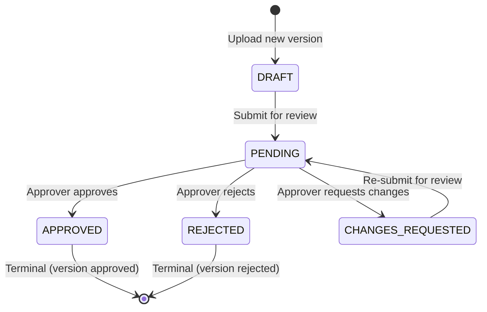
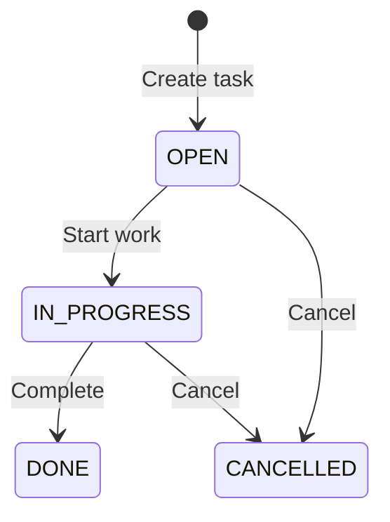

# KnowFlow — Approval Workflow State Machine

## Overview

The approval workflow governs document version review and publication. Every state transition is validated by an explicit state machine class — there are **no generic status setters** anywhere in the codebase.

---

## States

| State | Description | Who can trigger entry |
|-------|-------------|----------------------|
| `DRAFT` | Initial state. Version is uploaded but not submitted for review. | System (on upload) |
| `PENDING` | Submitted for review, awaiting approver action. | Owner / KNOWLEDGE_MANAGER (submit) |
| `APPROVED` | Reviewed and accepted by assigned approver. | Assigned APPROVER |
| `REJECTED` | Reviewed and rejected by assigned approver. | Assigned APPROVER |
| `CHANGES_REQUESTED` | Approver requests revisions before re-submission. | Assigned APPROVER |

---

## Transition Table

### Valid Transitions

| From State | To State | Action | Actor | Requirements |
|------------|----------|--------|-------|-------------|
| `DRAFT` | `PENDING` | Submit for review | Owner, KNOWLEDGE_MANAGER | Must specify version ID + approver ID. Self-approval blocked. Approver must have APPROVER role. Version must be in DRAFT/current. |
| `PENDING` | `APPROVED` | Approve | Assigned APPROVER only | Must be the assigned approver. Version must still be current (not superseded). Creates approval_history entry. Updates document status + current_version_id. Sends notification. |
| `PENDING` | `REJECTED` | Reject | Assigned APPROVER only | Must be the assigned approver. **Comment is required.** Creates approval_history entry. Sends notification. |
| `PENDING` | `CHANGES_REQUESTED` | Request changes | Assigned APPROVER only | Must be the assigned approver. Comment is required. Creates approval_history entry. Sends notification. |
| `CHANGES_REQUESTED` | `PENDING` | Re-submit | Owner, KNOWLEDGE_MANAGER | Can submit same version again or upload new version and submit that. |

### Invalid Transitions (All Rejected)

| Attempted | Why Blocked | Error |
|-----------|-------------|-------|
| `DRAFT` → `APPROVED` | Cannot skip review | 400 |
| `DRAFT` → `REJECTED` | Cannot skip review | 400 |
| `PENDING` → `DRAFT` | Cannot go backward | 400 |
| `APPROVED` → anything | Terminal state | 400 |
| `REJECTED` → anything | Terminal state | 400 |
| Any → Any (self-approval) | Self-approval always blocked | 403 |
| Any → Any (non-assigned approver) | Only assigned approver can act | 403/404 |
| Any → Any (duplicate decision) | Already decided | 409 |

---

## Business Rules

### 1. Self-Approval Prevention
- A user who submitted a version for review **cannot** be the approver.
- This is checked both at submission time (cannot assign yourself) and at decision time (defense in depth).
- Applies to ALL roles including ADMIN.

### 2. Version Binding
- An approval request is bound to a **specific document version** (not the document itself).
- Approving version 1 does not automatically approve version 2.
- If a new version is uploaded while version 1 is under review, it does NOT cancel or affect the review of version 1.

### 3. Outdated Version Protection
- When an approver tries to approve a version that is no longer the document's latest, the system should **warn** but still allow approval (the version content hasn't changed).
- The document's `current_version_id` is updated only if the approved version is newer than the current approved version.

### 4. Duplicate Decision Prevention
- If an approval request has already been decided (APPROVED/REJECTED/CHANGES_REQUESTED), any further decision attempt returns 409.
- Optimistic locking (`@Version`) prevents concurrent duplicate decisions.

### 5. Approval History Immutability
- `approval_history` is **append-only** at the application layer.
- The repository exposes NO `update()` or `delete()` methods for history records.
- Every state transition creates exactly one history entry with: actor, action, comment, from_state, to_state, timestamp.

### 6. Notifications
- On every state change, the system sends notifications to:
  - The document owner
  - The submitter (if different from owner)
  - The approver (for submission notifications)
- Notifications use dedupe keys to prevent duplicates on retry.

### 7. Document Status Sync
- When a version is **APPROVED**: document's `status` is updated to `APPROVED` and `current_version_id` points to the approved version.
- When a version is **REJECTED**: document's status remains unchanged (it may have other approved versions).
- The document's status represents its overall lifecycle, not just the latest approval.

---

## Transaction Boundaries

Each approval action (approve/reject/request-changes) executes in a **single database transaction** that:
1. Validates the current state and actor
2. Updates `approval_requests.status`
3. Creates `approval_history` entry
4. Updates `documents.status` and `current_version_id` (if approving)
5. Creates notification(s)

If any step fails, the entire transaction rolls back.

---

## Task Status Transitions

Tasks have their own simpler state machine:

| From | To | Actor | Notes |
|------|----|-------|-------|
| `OPEN` | `IN_PROGRESS` | Assignee | — |
| `OPEN` | `CANCELLED` | Assignee, Creator | — |
| `IN_PROGRESS` | `DONE` | Assignee | Completion note optional |
| `IN_PROGRESS` | `CANCELLED` | Assignee, Creator | — |
| `DONE` | — | Terminal | Cannot reopen |
| `CANCELLED` | — | Terminal | Cannot reopen |
